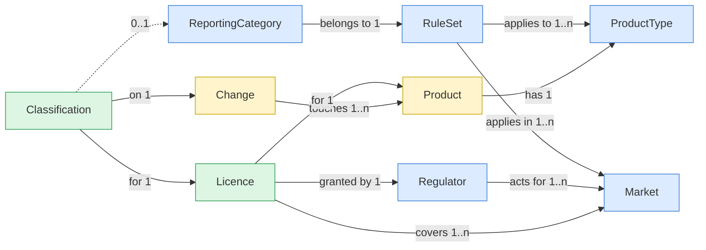

# 🧭 MEMO: where a change must be classified
 
> [!TIP]
> **One-line version:** a user classifies each **licence** a change touches. The licence's **markets** and the product's **type** decide which **rule set** applies, and the rule set offers the **categories** to pick from.
 
**Colour key:** 🟨 existing · 🟦 reference data (seeded) · 🟩 customer data (written by users)
 
---
 
## 🗺️ The model
 

 
## 🧱 Core concepts
 
| | Concept | What it is | Why it exists |
|---|---|---|---|
| 🟦 | **Market** | A country a licence can cover (ISO code) | Users see results per country |
| 🟦 | **Regulator** | Body that grants licences, acting for 1+ markets | The EC covers all EU/EEA; BfArM only Germany |
| 🟦 | **ProductType** | Synthetic or biological | Brazil has a separate rule set for each |
| 🟦 | **RuleSet** | A published scheme of categories for market × product type pairs | Where the categories come from |
| 🟦 | **ReportingCategory** | One category in one rule set, plus its **FilingRoute** | What the user picks; route makes markets comparable |
| 🟩 | **Licence** | A product's authorisation from one regulator, covering 1+ markets | One EU centralised licence = one row, many markets |
| 🟩 | **Classification** | One change × one licence: category, route only, or "not affected", with reasoning | The thing the user records |
 
## 🎯 Key decisions
 
- **Rule set ≠ regulator.** The UK, Switzerland, Saudi Arabia and South Africa reuse EU labels (`IA`, `IB`, `II`) but are separate rule sets. Codes are prefixed (`EU_IB`, `UK_IB`) so they never collide.
- **ASEAN is not a rule set.** Nobody files with ACCSQ-PPWG. Each member gets its own national rule set only where a primary source confirms one (E4). I relied on **E4 over E2**, e.g. for Cambodia.
- **Classify the licence, not the market.** One centralised EU licence gets one answer, shown in every market it covers.
- **Not stored, computed:** a licence's rule set (from its markets + product type) and "not yet classified" (an affected licence with no classification row).
---
 
## ⚠️ Deliberately not modelled
 
> [!WARNING]
> **Countries with no confirmed rule set** (Brunei, Cambodia, Lao PDR, Myanmar, Thailand, Timor-Leste)
> **v1:** the user records a filing route without a category, plus reasoning.
> **Model it when:** the domain team confirms each country's categories from a primary source.
 
> [!WARNING]
> **Rule set editions** (e.g. EU 2024/1701 replacing the old regulation)
> **v1:** only the current edition is held and updated in place. Reasoning is kept on each classification.
> **Model it when:** auditors need to see which edition a past classification was made under.
 
> [!WARNING]
> **EU procedure routes** (MRP / DCP / national)
> **v1:** each national licence is its own row under its national regulator. Same rule set either way.
> **Model it when:** filing planning comes into scope (coordination differs by route).
 
> [!WARNING]
> **One change that triggers several categories on one licence** (EU grouping)
> **v1:** record the most restrictive category; note the rest in reasoning.
> **Model it when:** grouping or worksharing decisions come into scope.
 
---
 
## ❓ Open questions
 
> [!IMPORTANT]
> | Question | Who decides |
> |---|---|
> | Which categories apply in each unconfirmed ASEAN country? Does Brunei's MaV/MiV procedure count as the AVG? | Domain team (ASEAN regulatory lead) |
> | Thailand cites the AVG "alongside other frameworks". Which one wins on a conflict? | Domain team |
> | Are two product types enough, or do vaccines, ATMPs or herbals need their own rule sets? | Domain team |
> | Must every classification record the rule set edition it used? | Product + QA / compliance |
 